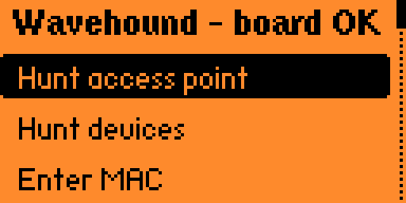

# Wavehound

**WiFi fox hunting for the Flipper Zero WiFi dev board, running ESP32 Marauder.**

Wavehound turns the Flipper and its ESP32 WiFi dev board — flashed with stock
[ESP32 Marauder](https://github.com/justcallmekoko/ESP32Marauder) **v1.19.0** —
into a 2.4 GHz WiFi direction finder. Pick an access point or device from a live
scan that fills as they are heard, or type in a MAC by hand, then walk around:
the Flipper clicks faster and the meter fills as the signal gets stronger.

<p align="center">
  
  
</p>

Typical uses:

- Find that forgotten access point, repeater or IoT plug hidden in a ceiling or closet.
- Track down a rogue AP on a network you administer.
- Locate your own lost phone, smart plug or camera by its MAC.

Wavehound is **receive-only**: it reads frame RSSI and never transmits.

## How it works

Wavehound is a thin UART client for the dev board. The board runs **stock ESP32
Marauder v1.19.0** (the `MARAUDER_FLIPPER` build); the app drives Marauder's
serial CLI — `scanall` to list networks and stations, `foxhunt` to track one
target's per-frame RSSI, `info` for board identity — and turns the raw RSSI
stream into a meter, a graph and Geiger clicks. The signal-strength smoothing,
trend arrow and click/haptic cadence are all computed on the Flipper.

```
┌──────────── Flipper Zero ─────────────┐        ┌──── WiFi dev board (ESP32) ────────┐
│  Wavehound.fap                        │  UART  │  ESP32 Marauder v1.19.0            │
│   ├ Targets: AP search, device search,│ 115200 │   ├ scanall -> AP + station list   │
│   │  manual MAC entry                 │◄──────►│   │                                │
│   ├ Hunt view: dBm, meter, graph,     │  pins  │   ├ foxhunt -> target RSSI stream  │
│   │  Geiger clicks (speaker)          │ 13/14  │   └ info -> board identity          │
│   └ 5V OTG on, expansion svc off      │        │                                    │
└───────────────────────────────────────┘        └────────────────────────────────────┘
```

Marauder references fox-hunt targets by their index in a list it builds during a
scan, and it rebuilds that list on every `scanall`. So Wavehound never keeps an
index around: to hunt anything (an access point, a station, a typed or saved
MAC) it first runs `add -a` with the MAC, which returns the entry's current index
(it is either added or reported as already present), then starts `foxhunt -w` with
that index and waits for the board to confirm the hunt started.

## Features

| Mode | What you see |
|------|--------------|
| **Hunt access point** | The board scans and the list fills live, adding each access point as it is heard (by SSID; hidden networks show their BSSID). Pick one the moment it appears or keep waiting. New entries append to the bottom so your highlight stays put. Pick one to open its details (vendor, type, signal), then hunt. |
| **Hunt devices** | First pick the scope: **All channels (hop)**, a **channel number**, or **Clients of nearby AP…**, which runs an AP scan so you can pick a network and then lists only the stations seen with it. The list fills live with access points left out — the stations (phones, laptops, plugs, cameras) Marauder saw associated with an AP. `*` marks a randomized (privacy) MAC that may change over time. Pick one for details, then hunt. (Marauder's AP/station scan always sweeps every channel, so a channel number here isn't a scan filter — it's the channel the hunt you start next will begin on.) With **Clients of nearby AP…** the same applies: the board still hops every channel and Wavehound filters the list down to that AP's clients, so it only listens on the AP's channel about 1/13 of the time — expect the client list to fill slowly. Marauder also counts a "client" loosely (any device whose data frame references the AP, not just truly associated stations, and it doesn't filter out multicast), so the list can include devices that aren't really on your network. Both are Marauder scan behaviors, not app bugs. |
| **Enter MAC** | Type a MAC on the hex keypad (pre-filled with your last target), then pick the channel: **Auto**, a channel number, or a nearby AP's channel. A chosen channel parks the hunt there and it stays there. Note: on the dev board Marauder's fox hunt can't sweep channels, so **Auto** (no known channel) just sits on one channel — the one Marauder already has for that MAC (from a scan), or channel 1 for a MAC it hasn't seen — and won't find a target elsewhere. The hunt screen shows which channel that is. Pick the channel, or a nearby AP's channel, whenever you know it. |
| **Device details** | After picking a scan result: SSID/name, MAC, **vendor** (resolved from the MAC's OUI), AP or station, channel and signal. For access points the security (Open/WEP/WPA/WPA2/WPA3) is fetched from the board and added to the line, e.g. `AP ch6 WPA2 -52dBm` (Marauder reports no 802.11 mode, so g/n/ac/ax is not shown). **Hunt** continues to the hunt; **Save** stores it as a favorite. Vendor resolution needs the `oui.db` database; without it, the vendor reads "no oui.db" (see [Vendor database](#vendor-database)). |
| **Hunt screen** | The board reports the signal strength of every frame the target MAC sends (beacons, data, probes). The screen shows a big dBm readout with the frame rate (frames/s) beside it, a COLD/COOL/WARM/HOT! label with a trend arrow for whether the signal is rising or falling as you move, a meter with a peak marker, and a 12-second signal graph. Geiger clicks play through the speaker, faster as the signal gets stronger. The corner shows the channel the board reports it is parked on: `?ch` means the hunt isn't hearing the target right now (it's quiet, or not on this channel), and `ch?` means the board hasn't confirmed the hunt yet. While the hunt starts, the readout says *starting...*; if the board doesn't answer or refuses the target it says so (*no board reply*, *MAC rejected*, *low board memory*, *start failed*), and *no board* appears if the link goes silent mid-hunt. The hunt stays parked on the channel it started on (on the dev board Marauder's fox hunt is fixed-channel), so a quiet target isn't lost — it just updates in bursts between its transmissions. Press **Right** to save the current target as a named favorite. An optional haptic buzz, a kept-on backlight and the meter's Near/Normal/Far range are configurable under **Settings**.<br><br>**When a target goes missing:** since the hunt can't change channel, it only hears a target that's actually on the parked channel. If the device roams to another channel — or to 5 GHz, which this 2.4 GHz-only board can't see at all — it drops out until you re-scan and hunt it again on its new channel. |
| **Saved MACs** | Favorites you saved from the hunt screen, kept on the SD card (`/ext/apps_data/wavehound/saved.txt`). Pick one for **Hunt / Edit / Delete**. Hunt opens the channel picker with the saved channel pre-selected. Edit fixes the name, MAC or channel. Delete removes it. |
| **Board info** | Ask Marauder about itself: firmware version, hardware name, app partition, ESP-IDF version and the board's MAC addresses. |
| **Settings** | Tweak how the hunt behaves; kept on the SD card (`/ext/apps_data/wavehound/settings.txt`). **Click volume** (0.1–1.0) sets the Geiger click loudness. **Sound** (On/Muted) is the hunt screen's starting mute state. **Saved hunt ch** (Saved / Auto-hop / Nearby AP) is which channel option is pre-selected when you hunt a saved MAC. **Range** (Near / Normal / Far) shifts the dBm window the meter spans — Near −75..−25, Normal −95..−30, Far −100..−50 — and retunes the click and haptic rate. **Haptic** (Off/On) buzzes the Flipper as a proximity cue (works even when muted). **Keep backlight** (Off/On) holds the backlight on while a hunt is on screen. |

Controls:

- **Hunt:** OK = mute/unmute, Left = reset peak, Right = save target, Back = return to the list
- **Target list (live scan):** scroll and pick any entry while scanning continues; the first entry, "~ Search again", clears the list and restarts the scan; Back stops scanning and returns

## Layout

The Flipper external app (uFBT) lives at the repo root:

```
application.fam         app manifest (appid, fap_version, assets)
wavehound.c             entry, board power/expansion handling, board line parser
wh_marauder.c           Marauder command builders + serial line parsers
wh_uart.c               USART worker, line splitting, keep-alive poll
scenes/                 one file per screen (start, channel select,
                        target list, details, MAC input, hunt,
                        board info, name input, saved MACs, saved entry,
                        edit saved, settings, about)
wh_store.c              saved MACs: load/add/update/delete on the SD card
wh_settings.c           app settings: load/save on the SD card
wh_oui.c                vendor lookup from the SD oui.db
views/wh_hunt_view.c    hunt screen + Geiger click thread
assets/                 bundled file assets (oui.db, generated by build_app.py)
catalog/                Flipper Apps Catalog submission (manifest, changelog, shots)
tools/gen_oui.py        build oui.db (vendor database) from Wireshark's manuf
build_app.py            generate+bundle oui.db, then build the app (ufbt)
docs/MARAUDER_PROTOCOL.md  the subset of Marauder's serial CLI the app uses
```

## Vendor database

The device-details screen shows the manufacturer behind a MAC, resolved from
its OUI (the first 3 bytes). Vendor names come from `oui.db`, a sorted
fixed-width binary (3-byte OUI + name) the app binary-searches by seeking, so
it stays fast and never loads into RAM.

<p align="center">
  
</p>

`oui.db` is not checked in: `build_app.py` generates it into
`assets/oui.db`. The manifest bundles that folder
(`fap_file_assets`), so the Flipper unpacks it to
`/ext/apps_assets/wavehound/oui.db` when the app is installed.

The app looks for the database in two places, in order:

1. `/ext/apps_data/wavehound/oui.db` — your own drop-in (overrides, newer data)
2. `/ext/apps_assets/wavehound/oui.db` — the bundled copy

So it works out of the box, and you can refresh the data without rebuilding by
dropping a newer `oui.db` in `apps_data`. The data comes from Wireshark's
`manuf` (derived from the IEEE registry); redistribute per its terms with
attribution.

## 1. Flash the dev board with ESP32 Marauder

Wavehound needs the dev board running **ESP32 Marauder v1.19.0** (the
`MARAUDER_FLIPPER` build for the official ESP32-S2 WiFi dev board). Follow the
Marauder project's own flashing instructions:

- Marauder firmware and docs: <https://github.com/justcallmekoko/ESP32Marauder>
- Flash the pre-built `MARAUDER_FLIPPER` release for the WiFi dev board, or
  build it yourself from the Marauder repo.

Wavehound drives Marauder over its serial CLI at 115200 baud on the Flipper's
dev-board header (GPIO 13/14), which Marauder's Flipper build uses by default.
Older or newer Marauder versions may change command output; Wavehound targets
**v1.19.0**.

## 2. Build and install the Flipper app

From the repo root, `build_app.py` downloads Wireshark's `manuf`, generates the
vendor database and then runs `ufbt` for you:

```bash
pipx install ufbt   # or: pip install ufbt inside a venv
python3 build_app.py            # build -> dist/wavehound.fap
python3 build_app.py --launch   # build, upload over USB and run
```

Other options:

```bash
python3 build_app.py --manuf path/to/manuf  # use a local manuf file instead
python3 build_app.py --no-build             # only (re)generate the db
python3 build_app.py --skip-db              # just build (keep the existing oui.db)
```

(`tools/gen_oui.py` is the underlying generator if you want to run it directly.)
Running `ufbt` in the repo root directly also works and reuses an `oui.db`
generated earlier; on a fresh clone the app is then built without one and shows
the vendor as "no oui.db".

Or copy `dist/wavehound.fap` to `SD:/apps/GPIO/ESP/` with qFlipper.
The app shows up under **Apps → GPIO → ESP → Wavehound**. Built against official
firmware SDK 1.5.1 (API 88.2).

## 3. Use it

1. Plug the Marauder-flashed dev board onto the Flipper and open Wavehound. The
   app turns on 5 V on the GPIO header and takes over the USART from the
   expansion service.
2. The menu header changes to **"Wavehound - board OK"** once the board answers.
3. Pick a target: **Hunt access point**, **Hunt devices** or **Enter MAC**.
   Then start walking. Hold the Flipper away from your body and turn slowly.
   Your body blocks the signal, so the strongest reading points toward the
   source. **Settings** tunes clicks, haptics, backlight and the meter range.

Hunting phones and other client devices works best while they are in use. An
idle phone may only transmit every few seconds, so the readout updates in
bursts. Phones also rotate randomized MACs (`*`), so a MAC you found yesterday
may not exist today.

## Protocol

Wavehound speaks Marauder's plain-text serial CLI, so you can drive the board
from any serial terminal too. The exact subset Wavehound uses — commands sent
and the reply lines it parses — is documented in
[docs/MARAUDER_PROTOCOL.md](docs/MARAUDER_PROTOCOL.md).

## Disclaimer

This is a hobby project, provided as-is and without any warranty. Everything
here is developed and tested on my own original hardware — a genuine Flipper
Zero and the official WiFi dev board. I can't vouch for clones, other hardware
or other setups, and I don't guarantee it won't damage, brick or otherwise break
your hardware. You are responsible for anything that happens to your Flipper, dev
board or other equipment. Flashing ESP32 Marauder is covered by that project's
own terms and risks.

This code is AI-assisted: much of it was written with the help of AI tools.
Review it yourself before trusting it or flashing hardware.

Only locate networks and devices you own or are explicitly authorized to locate,
and only on your own network. Wavehound is receive-only, and passive reception is
legal in most places, but radio and privacy rules vary by jurisdiction. Checking
what you are allowed to do, and getting permission first, is up to you.

## License

MIT. See [LICENSE](LICENSE).
